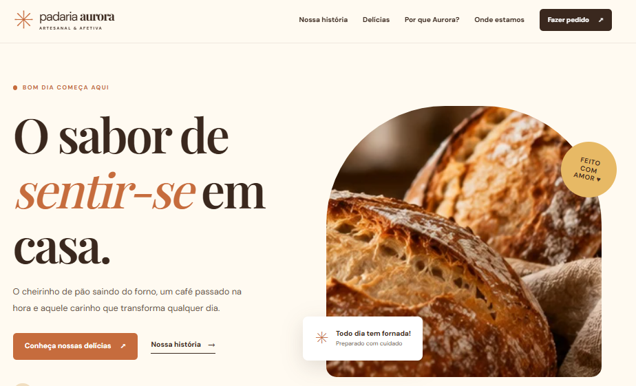
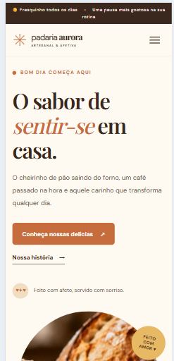
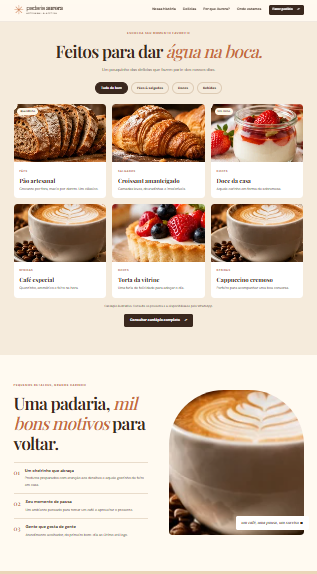

# 🥐 Padaria Aurora — Website Responsivo

Landing page demonstrativa para uma **padaria artesanal fictícia**, desenvolvida como projeto de portfólio frontend.

O site apresenta uma identidade visual acolhedora, navegação responsiva, catálogo de produtos com filtros interativos e integração demonstrativa com WhatsApp.

🌐 **[Acessar o site publicado](https://jefersonalvesrs.github.io/padaria-aurora/)**

> **Projeto fictício:** nome, telefone, endereço, horários e produtos são demonstrativos e não representam uma empresa real.

## 📸 Prévia do projeto

### Versão desktop



### Versão mobile



### Catálogo e seções internas



## ✨ Funcionalidades

- Layout responsivo para desktop, tablet e celular.
- Menu mobile com botão hambúrguer, indicação de estado e fechamento pela tecla `Escape`.
- Navegação entre as seções da página.
- Catálogo de produtos com filtros: **Todos**, **Pães e salgados**, **Doces** e **Bebidas**.
- Links demonstrativos para pedidos e contato via WhatsApp, com mensagens pré-preenchidas.
- Seções institucionais, apresentação de produtos, diferenciais e contato.
- Link demonstrativo de pesquisa no Google Maps.
- Ano do rodapé atualizado automaticamente via JavaScript.
- Botão **Voltar ao topo** com rolagem suave.
- Recursos básicos de acessibilidade, incluindo textos alternativos, atributos ARIA e suporte à redução de movimento.

## 🛠️ Tecnologias utilizadas

| Tecnologia | Aplicação |
| --- | --- |
| HTML5 | Estrutura semântica e conteúdo |
| CSS3 | Estilização, layout e responsividade |
| JavaScript | Menu mobile, filtros, ano do rodapé e navegação |
| Google Fonts | Fontes DM Sans e Playfair Display |

O projeto é **100% frontend e estático**, sem frameworks, backend, banco de dados ou ferramentas de build.

## 📁 Estrutura do projeto

```text
padaria-aurora/
├── assets/
│   ├── favicon.svg
│   ├── hero-paes.webp
│   ├── historia-croissants.webp
│   ├── pao-artesanal.webp
│   ├── croissant.webp
│   ├── doce-da-casa.webp
│   ├── cafe.webp
│   ├── bolos-tortas.webp
│   ├── cafe-com-leite.webp
│   └── ambiente-cafe.webp
├── screenshots/
│   ├── desktop.png
│   ├── mobile.png
│   └── produtos.png
├── index.html
├── styles.css
├── script.js
└── README.md
```

As imagens utilizadas no site estão armazenadas localmente na pasta `assets/`, em formato WebP.

## 🚀 Como executar localmente

1. Clone ou baixe este repositório.
2. Abra a pasta `padaria-aurora` no Visual Studio Code.
3. Abra o arquivo `index.html` no navegador ou utilize a extensão **Live Server**.

Não é necessário instalar dependências.

## 📱 Responsividade

O CSS possui ajustes para diferentes resoluções, incluindo pontos de quebra próximos de **1020 px, 800 px e 520 px**.

Em dispositivos móveis, o menu de navegação se torna recolhível e os cards são reorganizados para facilitar a leitura e a interação.

## ⚙️ Personalização

Para adaptar o projeto a um negócio real:

1. Substitua o nome, a identidade visual e os textos da Padaria Aurora.
2. Atualize o número demonstrativo `5554999999999` nos links `wa.me` pelo WhatsApp comercial correto.
3. Configure endereço, horários e localização no Google Maps.
4. Revise os produtos, preços e disponibilidade.
5. Substitua as imagens ilustrativas por fotografias autorizadas dos produtos reais.
6. Atualize o `<title>`, a meta description, o favicon e os dados de contato.
7. Teste os links, filtros, menu e responsividade antes da publicação.

## 🖼️ Imagens e fontes

- As imagens de produtos e ambiente são **ilustrações geradas por inteligência artificial**, utilizadas exclusivamente para demonstração visual.
- O favicon é um arquivo SVG do próprio projeto.
- As fontes **DM Sans** e **Playfair Display** são carregadas pelo Google Fonts, com fontes alternativas definidas no CSS.

## 🌐 Hospedagem

O projeto está publicado gratuitamente por meio do **GitHub Pages**.

**Site:** https://jefersonalvesrs.github.io/padaria-aurora/

Por ser estático, também pode ser hospedado em plataformas como Netlify e Vercel.

## ♿ Acessibilidade

O projeto inclui HTML semântico, link para pular ao conteúdo, atributos ARIA, textos alternativos, foco visível e suporte a `prefers-reduced-motion`.

Esses recursos contribuem para a acessibilidade, mas não substituem uma auditoria completa.

## 🔒 Privacidade

O site não possui login, formulários próprios de coleta, banco de dados ou cookies próprios implementados.

Links para WhatsApp e Google Maps, assim como o carregamento de fontes do Google Fonts, podem envolver serviços externos e suas respectivas políticas de privacidade.

## 📌 Status do projeto

**Concluído — versão demonstrativa de portfólio.**

- Layout responsivo implementado.
- Funcionalidades frontend desenvolvidas.
- Imagens armazenadas localmente.
- Capturas de tela documentadas.
- Publicação realizada no GitHub Pages.

Os dados comerciais permanecem fictícios.

## 👨‍💻 Desenvolvedor

**Jeferson Alves**

[GitHub](https://github.com/JefersonAlvesrs)

Projeto desenvolvido para demonstrar habilidades em **HTML, CSS, JavaScript, responsividade e desenvolvimento de interfaces web**.